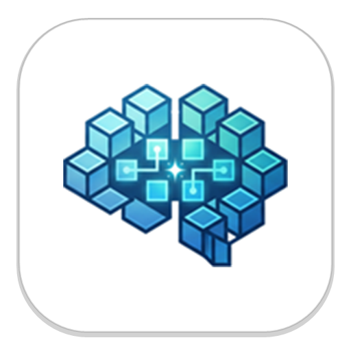
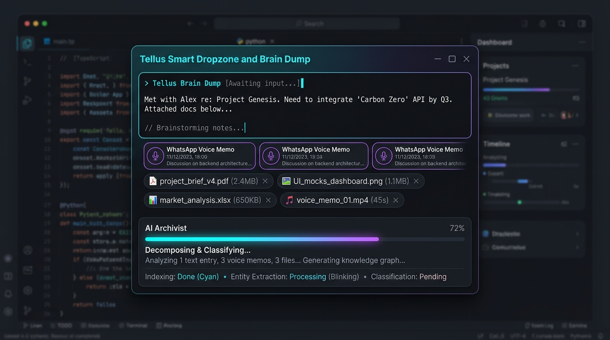
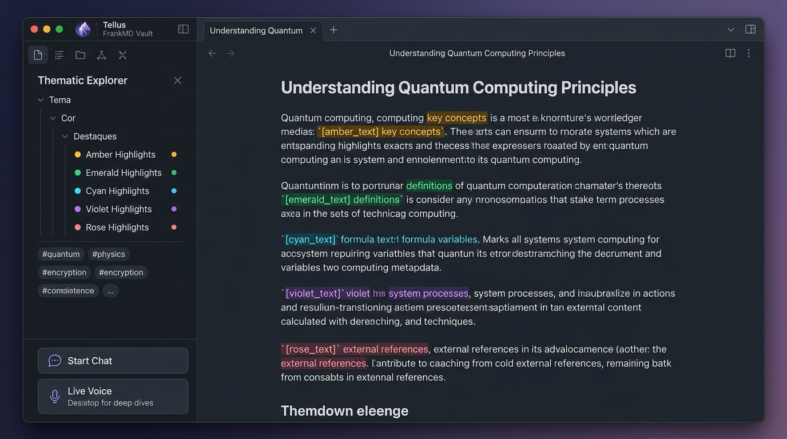
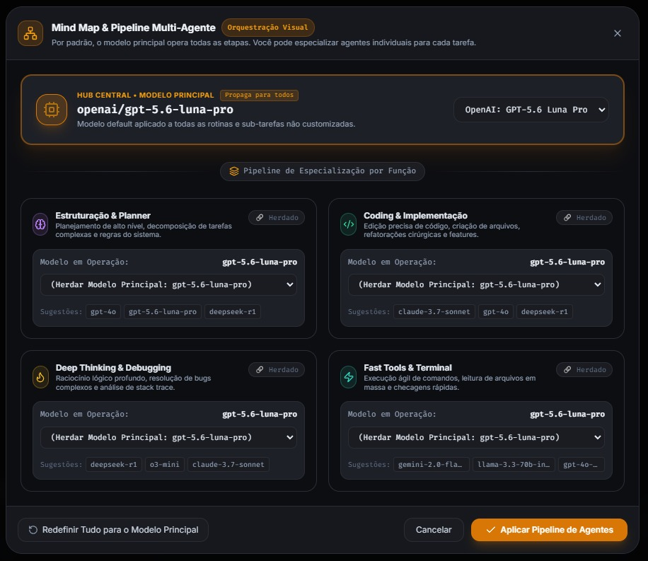
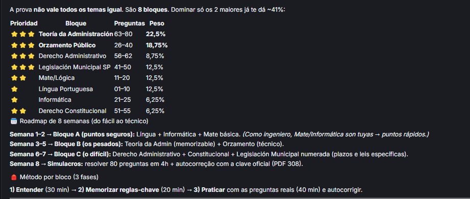
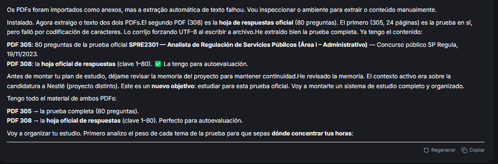
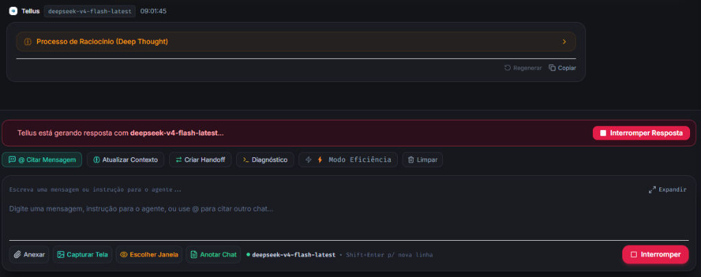

<div align="center">



# 🌐 Tellus (Agentic IDE)
### *Ambiente Integrado de Desenvolvimento Agêntico, Gestão de Conhecimento Obsidian/TellusMD e Engenharia de Carreira*

[](https://react.dev/)
[](https://www.typescriptlang.org/)
[](https://nodejs.org/)
[](https://tailwindcss.com/)
[](https://obsidian.md/)
[](LICENSE)
[](LICENSE)

</div>

---

## 📌 Visão Geral

**Tellus** é uma IDE agêntica de nova geração que combina orquestração multi-modelo de inteligência artificial, execução local segura de ferramentas de código e terminal, curadoria de memória de longo prazo e um ecossistema completo de gestão de conhecimento compatível com **Obsidian Markdown (`TellusMD Vault`)**.

Projetado para engenheiros de dados, desenvolvedores e pesquisadores, o Tellus transforma requisitos complexos de vagas e editais em planos de estudo e projetos práticos, organizando despejos caóticos de anotações (mensagens de WhatsApp, transcrições de vídeos e anexos multimídia) em um cofre de conhecimento interconectado por grafos e destaques temáticos.

---

## 🖼️ Capturas de Tela do Sistema

<div align="center">

### 📥 1. Smart Dropzone Multimodal & Console de Brain Dump
*Área unificada para despejo de notas do WhatsApp, transcrições de vídeos, ideias soltas e arquivos multimídia (PDF, imagens, planilhas), com decomposição automática pelo AI Archivist e relatório detalhado de organização.*


---

### 🎨 2. Explorador Temático & Destaques Hierárquicos (Tema ➔ Cor ➔ Destaques)
*Interface limpa de visualização inspirada no Notion/Goodnotes focada em conteúdo: filtro hierárquico por tema e paleta de marca-texto, busca temática universal e hub de ações rápidas para iniciar Chat, Live Voice com o Orbe ou compilar trilhas de estudo.*


---

### 💻 3. Workspace Agêntico, Engenharia de Carreira & Links Clicáveis
*Interface moderna de chat com renderização rica de estratégias de vagas, links interativos para notas no Vault e painel lateral.*


---

### 📚 4. TellusMD Vault, Pastas Obsidian & Lixeira com Retenção
*Cofre compatível com Obsidian, árvore de pastas hierárquica, editor split com preview em tempo real e controle completo de retenção da lixeira.*


---

### 🧭 5. Orquestração Multi-Agente Visual (Pipeline Mind Map)
*Mapeamento visual e especialização de papéis entre modelos (Hub Central, Planner, Coding, Deep Thinking, Fast Tools).*


---

### ⚡ 6. Raciocínio Profundo (Deep Thought) & Streaming Contínuo
*Streaming em tempo real com processo analítico de raciocínio, citação de mensagens, atualização de contexto e modo eficiência.*


</div>

---

## ✨ Principais Funcionalidades

### 📥 1. Smart Dropzone Unificado & Brain Dump Multimodal
- **Entrada Única Multimodal:** Sem necessidade de alternar entre abas isoladas. Cole longos despejos de texto (mensagens encaminhadas do WhatsApp, transcrições brutas do YouTube, anotações de reuniões) e anexe arquivos simultaneamente (PDFs, imagens, planilhas, trechos de código).
- **Decomposição em Múltiplos Tópicos:** O motor do **AI Archivist** decompõe despejos mistos em notas atômicas independentes, evitando misturar assuntos distintos.
- **Contextualização com o Cofre:** O agente inspeciona as pastas e notas existentes no Vault para decidir onde cada nota se encaixa melhor.
- **Relatório de Auditoria Transparente:** Cada processamento gera um relatório detalhado em `Relatórios de Organização/`, explicando *o porquê* e *o como* de cada nota ter sido arquivada e classificada.

### 🎨 2. Gestão de Destaques Hierárquicos (Tema ➔ Cor ➔ Destaques)
- **Design Focado em Legibilidade:** Visualização clean, sem pontilhados ou linhas distrativas. Foco total em hierarquia de conteúdo, tipografia e escaneabilidade rápida.
- **Hierarquia 3 Níveis:**
  1. **Tema / Assunto:** Carrossel dinâmico dos principais temas extraídos das pastas, tags e assuntos do Vault.
  2. **Cor do Marca-Texto:** Paleta semântica com contadores em tempo real (Amarelo, Verde, Azul, Roxo, Rosa, etc.).
  3. **Destaques & Citações:** Cartões com o trecho exato, nota de origem, wikilink e pasta.
- **Thematic Action Hub (Ações Rápidas):**
  - 💬 **Abrir Chat Temático:** Inicia uma conversa com o Tellus trazendo todos os destaques do tema selecionado para aprofundamento.
  - 🎙️ **Live Voice com o Orbe:** Dispara uma sessão de voz interativa para debater e fixar o conteúdo.
  - 📁 **Criar Trilha no Vault:** Compila todos os destaques em um roteiro consolidado (`00_Roteiro_...`) dentro de `Estudos/Trilhas/`.
  - ❓ **Botão "Perguntar" em Cada Destaque:** Envia diretamente para o chat uma solicitação contextualizada sobre a citação.

### 🧠 3. Orquestração Multi-Modelo e Agentes Especializados
- **Suporte Nativo a Provedores:** Integração com OpenRouter, Google Gemini, Anthropic Claude, OpenAI e DeepSeek.
- **Divisão de Papéis em Pipeline:**
  - `Planner / Architect:` Decomposição de tarefas complexas e roteiros de estudo.
  - `Deep Reasoning:` Raciocínio analítico avançado com *DeepSeek R1*.
  - `Fast Tools & Coder:` Ferramentas e automação ágil com *Gemini 2.5 Flash / DeepSeek V4 Flash*.
  - `AI Archivist:` Classificação, decomposição de texto e arquivamento de documentos no Vault.

### 🗂️ 4. TellusMD Vault (Cofre de Conhecimento Obsidian)
- **Compatibilidade 100% Obsidian:** Arquivos `.md` padrão com suporte a `[[Wikilinks]]`, tags `#tag` e metadados frontmatter.
- **Visualização em Grafo Interativo:** Grafo de conexões com simulação física (repulsão, gravidade, colisão e conexões entre conceitos).
- **Lixeira com Retenção Configurável:** Proteção contra exclusão acidental via diretório `.backups` com retenção de 30, 90, 120 dias, 1 ano ou permanente.

---

## 💰 Avaliação de Custos & Viabilidade via OpenRouter

O Tellus utiliza nativamente o hub de provedores (`ProviderHub`) conectado à API do **OpenRouter** através da variável de ambiente `OPENROUTER_API_KEY`:

| Modelo | Entrada (1M tokens) | Saída (1M tokens) | Custo Médio por Lote (10k chars / ~3k tokens) |
| :--- | :--- | :--- | :--- |
| **Google Gemini 2.5 Flash** | ~\$0.075 | ~\$0.30 | **\$0.00045** (< R\$ 0,01) |
| **DeepSeek Chat (V3/V4)** | ~\$0.14 | ~\$0.28 | **\$0.00060** (< R\$ 0,01) |
| **DeepSeek R1 (Reasoning)** | ~\$0.55 | ~\$2.19 | **\$0.00350** (~ R\$ 0,02) |

> [!TIP]
> **Extrema Eficiência:** Um lote com 15 mensagens longas do WhatsApp e 3 arquivos anexados consome menos de R$ 0,01 para ser totalmente decomposto, categorizado e arquivado no Vault. Nenhuma conta adicional ou infraestrutura externa proprietária é necessária.

---

## 🛡️ Política de Versionamento & Segurança Local

O projeto adota diretrizes estritas de segurança, privacidade e higienização antes de qualquer commit ou submissão para a branch principal (`main`):

```bash
# 1. Auditoria de status e arquivos não rastreados
git status

# 2. Verificação estrita de compilação sem erros
npm run build   # Frontend (client)
npm run build   # Backend (server)

# 3. Blindagem de segredos e credenciais (.gitignore)
# Zero chaves de API, arquivos .env ou dados pessoais rastreados
```

### Regras de Ouro de Segurança:
1. **Blindagem de Segredos:** Arquivos `.env`, `config.json`, chaves e credenciais jamais são commitados.
2. **Privacidade Absoluta:** Conversas pessoais (`Chats/`), anotações de vagas, currículos e vaults locais são 100% blindados pelo `.gitignore`.
3. **Caminhos Dinâmicos:** Nenhum caminho absoluto ou específico de máquina é hardcoded; o Tellus resolve caminhos dinamicamente a partir do diretório do usuário (`os.homedir()`).
4. **Sanitização de Dados:** Bancos locais (`*.db`, `*.sqlite`), uploads temporários e pastas de cache (`.agentic/attachments/`, `scratch/`) são estritamente ignorados.
5. **Compilação Limpa:** Todo merge exige aprovação de `tsc --noEmit` e `vite build` sem warnings impeditivos.
6. **Imagens Oficiais:** O repositório armazena apenas mockups e diagramas gerados do sistema, preservando dados pessoais de conversas.

---

## 🏗️ Arquitetura do Projeto

```text
Tellus/
├── client/                     # Frontend React 19 + TypeScript + Vite + TailwindCSS
│   ├── src/
│   │   ├── components/
│   │   │   ├── ChatArea.tsx              # Chat com renderizador Markdown, Voice Orbe & Chips
│   │   │   ├── TellusNoteView.tsx        # Cofre TellusMD / Obsidian, Destaques Temáticos & Grafo
│   │   │   ├── NoteInkCanvas.tsx         # Canvas vetorial de caligrafia e desenho livre (Ink)
│   │   │   ├── TellusCodeStudio.tsx      # Editor Monaco multi-abas, atalhos VS Code & Prettier
│   │   │   ├── MaterialFileIcon.tsx      # Sistema completo de ícones Material por extensão/pasta
│   │   │   ├── SmartDropzoneModal.tsx    # Dropzone Unificado & Brain Dump Multimodal
│   │   │   ├── SettingsModal.tsx         # Configurações de API Keys, Modelos e Retenção
│   │   │   ├── OnboardingModal.tsx       # Wizard de Boas-Vindas e Setup de Primeiro Uso
│   │   │   ├── PatchNotesModal.tsx       # Modal de novidades e notas da versão v1.0.0
│   │   │   ├── PipelineMindMapModal.tsx  # Mindmap de orquestração multi-agente
│   │   │   └── Sidebar.tsx               # Navegação de projetos, histórico, rotinas e menu de contexto
│   │   ├── api.ts                        # Cliente REST & WebSocket para comunicação com o backend
│   │   └── types.ts                      # Definições de tipos TypeScript
│   └── vite.config.ts
│
├── server/                     # Backend Node.js + Express + TypeScript
│   ├── src/
│   │   ├── services/
│   │   │   ├── agentLoop.ts              # Loop autônomo do agente, invocação de tools e streaming
│   │   │   ├── configManager.ts          # Gestão persistente de configurações locais
│   │   │   ├── sync/                     # Sincronização em Nuvem (Drive/OneDrive) com 2FA AES-256-GCM
│   │   │   ├── notes/
│   │   │   │   ├── tellusNoteEngine.ts   # Motor do Vault (CRUD, Grafo, Pastas & Lixeira)
│   │   │   │   └── smartOrganizer.ts     # AI Archivist (Decomposição, Classificação & Relatórios)
│   │   │   ├── providers/
│   │   │   │   ├── providerHub.ts        # Hub unificado OpenRouter / Gemini / DeepSeek / Claude
│   │   │   │   └── openrouter.ts         # Streaming SSE resiliente para OpenRouter e LLMs
│   │   │   └── tools/
│   │   │       ├── fileParser.ts         # Extração de PDF, CSV e arquivos multimídia
│   │   │       ├── fileManager.ts        # Manipulação de arquivos do projeto
│   │   │       └── terminalRunner.ts     # Execução local segura de comandos e scripts
│   │   └── index.ts                      # Rotas da API REST, formatador Prettier e endpoints
│   ├── tests/                  # Suíte de mais de 80 testes automatizados
│   └── tsconfig.json
│
└── docs/                       # Recursos visuais e documentação oficial
    └── assets/                 # Mockups e imagens de alta resolução
```

---

## 🚀 Como Executar Localmente

### Pré-requisitos
- [Node.js](https://nodejs.org/) (versão 18 ou superior)
- [npm](https://www.npmjs.com/) ou [pnpm](https://pnpm.io/)

### 1. Clonar o Repositório
```bash
git clone https://github.com/lucasyamaguchi/Tellus.git
cd Tellus
```

### 2. Instalar Dependências
```bash
# Dependências do backend
cd server
npm install

# Dependências do frontend
cd ../client
npm install
```

### 3. Iniciar o Ambiente de Desenvolvimento
```bash
# Terminal 1 - Backend (Porta 3001)
cd server
npm run dev

# Terminal 2 - Frontend (Porta 5173)
cd client
npm run dev
```

Acesse o Tellus em seu navegador: `http://localhost:5173`.

---

## 🔒 Segurança e Privacidade

- **Armazenamento 100% Local:** Suas notas do Vault, configurações e histórico de projetos permanecem na sua máquina.
- **Comunicação Direta via HTTPS:** As chamadas de inferência trafegam diretamente para os endpoints seguros das APIs oficiais.
- **Zero Retenção Indesejada:** Suas anotações privadas nunca são utilizadas para treinamento público.

---

## 📄 Licença

Distribuído sob a licença **MIT**. Consulte o arquivo [LICENSE](LICENSE) para obter detalhes.

<div align="center">
  <sub>Desenvolvido com foco em autonomia, clareza e alta performance no Tellus IDE.</sub>
</div>